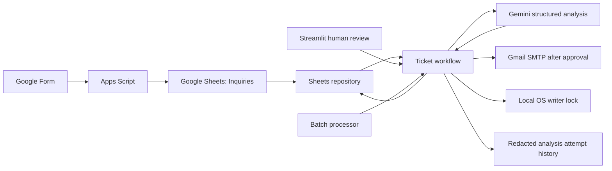

# Architecture

`models/ticket.py` defines analysis and stored-row validation. `services/storage.py` defines the repository contract, shared update validation, and Sheets-only source selection. `services/sheets_service.py` reads and updates the online Sheet by stable ticket ID using RAW writes. Missing credentials or invalid sources produce errors instead of creating local data.

`services/ticket_service.py` manages NEW → DRAFTED/ERROR, DRAFTED → APPROVED, and explicit ERROR → NEW retries. Approval persists the edited response before email delivery. Delivery status prevents ordinary repeat sends and flags uncertain outcomes for review. `READ_ONLY=true` blocks business mutations.

WhatsApp Business API and website customer request integrations are planned for later releases. They are not active data sources. All current requests must reach the configured Google Sheet.

`services/writer_lock.py` enforces a nonblocking single-writer operation across threads and processes using the same project directory, keyed by Sheet ID. The lock covers complete processing/approval/send/reset operations, and direct adapter updates participate in the same lock. Send intent additionally checks the expected email state. This is local serialization, not distributed compare-and-swap: other checkouts, computers, manual Sheet edits, and Apps Script operations are outside its scope. Intake appends can continue, but do not sort/delete existing rows while Python is writing.

`services/ai_service.py` returns validated analysis plus model/attempt metadata. Automatic discovery is enabled by default through `services/model_discovery.py`: it queries generation-capable general-purpose Gemini text candidates, excludes specialized models, orders stable Flash candidates first, and caches metadata for five minutes per credential fingerprint. The preferred model and optional manual fallbacks come first; duplicates are removed. No customer content is sent for discovery. Model listing does not prove current capacity or JSON Schema compatibility.

Attempts are bounded, and each generation request receives a share of the remaining budget (90 seconds by default) to leave room for later models. Busy/server failures, timeouts, missing/incompatible candidates, and invalid model output in automatic mode advance to the next candidate. Authentication, rate limits, provider retry guidance, and non-timeout connection failures stop the batch without marking untouched records ERROR. Exhausted output-validation failures remain per-ticket errors. Discovery failure may use explicitly configured candidates. The synchronous SDK may exceed the scheduling budget due to transport/cleanup overhead; there is no hard cancellation deadline. `GEMINI_AUTO_DISCOVER=false` retains configured-only operation.

`services/audit_service.py` appends redacted analysis outcomes to ignored local diagnostic storage. A GENERATED event does not confirm the subsequent Sheet write. Audit failures stop processing before saving a new draft. This file is not an inquiry source or durable outbox.

`ApprovalResult` separates saved/unknown approval from `DeliveryResult` fields for attempted send, SMTP acceptance, tracking persistence, and last known delivery state. Storage failures after approval return explicit partial outcomes. Unknown deliveries remain SENDING/UNKNOWN until explicit reconciliation. A lost approval-write response is checked by exact readback and never triggers email on that recovery path.

`StoredTicket` validates source rows, workflow state, reply bounds, and timezone-aware timestamps. `services/errors.py` exposes only deliberately authored application messages; validation errors contain safe row/field names rather than source/provider values. SMTP delivery still cannot be committed atomically with a Sheet update. Shared hosting requires transactional claims/revisions, an outbox, authentication, and recovery procedures.
