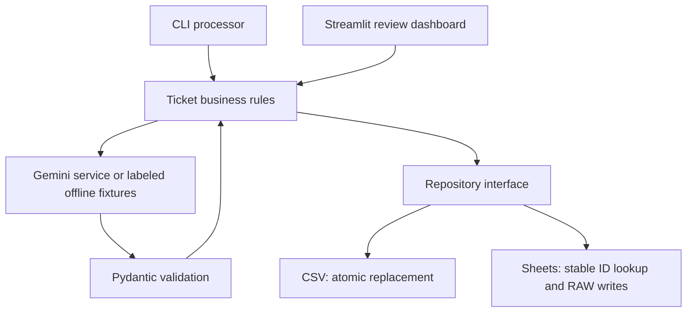

# Architecture

`models/ticket.py` defines the analysis contract and stored-row validation. `services/ticket_service.py` handles processing and review transitions. `services/storage.py` defines CSV storage and source selection. `services/sheets_service.py` provides the same repository operations through Sheets. The interface and CLI never make direct Google requests.

NEW → DRAFTED → APPROVED. Analysis failures produce ERROR. A person explicitly resets ERROR → NEW after resolving the issue. Approvals record final text and a UTC timestamp. No outgoing messaging service exists.

Configuration is loaded from the project-root `.env`, independently of the current directory. Environment variables take precedence. Missing global Gemini configuration is caught before changing NEW tickets. Individual analysis failures persist only a safe exception type; persistence failures halt the batch.

Use one writer: a status check prevents ordinary stale review actions but cannot atomically claim a record across processes. Production would require transactional storage, a job queue, access control, audit history, and reviewed data/privacy policies.
